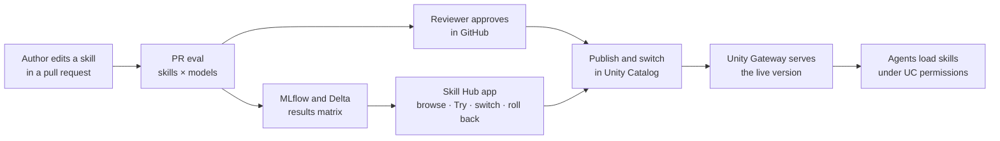

# Agent Skill Eval on Databricks

Register agent skills (`SKILL.md` bundles) in Unity Catalog, serve them to agents through Unity Gateway under Unity Catalog permissions, and evaluate every skill version against any set of models, with the evidence kept in MLflow and Delta.

**Status:** first release (registry, evaluation engine, CI/CD gates, Skill Hub basics). Some features are Beta; see `docs/architecture.md`.

## Quick start

```bash
uv venv --python 3.12
uv sync
uv run skillhub lint
uv run pytest -q
```

Configuration is in `config/hub.yaml`, and its `${VAR}` values come from the environment.

## What it does

- **Skills registry:** common and department-specific skills as Unity Catalog securables. Versions can be published, switched and rolled back.
- **Skill evaluation:** whether a skill is invoked when it should be (and not when it shouldn't), and how much it improves results compared with the same model without the skill. Results form a matrix across skill versions and models, scored with MLflow judges.
- **CI/CD:** GitHub Actions evaluate every skill change on its pull request. A reviewer approves the new version before it goes live.
- **Skill Hub:** a Databricks App for browsing skills, running evals, reviewing results on a Dashboard tab and switching versions, governed by Unity Catalog permissions. Authors and reviewers also see and evaluate skills that are still under review in a pull request, or that they upload as drafts.



See [docs/architecture.md](docs/architecture.md) for the components and the pull request and merge flows.

## Repository layout

| Path | Contents |
|---|---|
| `skills/` | Skill bundles by department, with their evaluation cases and rubrics |
| `config/hub.yaml` | Deployment settings: catalog, departments, model profiles, thresholds |
| `src/skillhub/` | Python package and `skillhub` CLI |
| `app/` | Skill Hub app |
| `resources/`, `databricks.yml` | Databricks bundle: jobs, app, schemas |
| `.github/workflows/` | CI/CD pipelines |
| `docs/` | Architecture, operations, API and onboarding guides |
| `fixtures/` | Synthetic test data for evaluation, with the Northwind Robotics suite |
| `scripts/` | Repository helpers, such as `scripts/configure_github.sh` and the review recorder `scripts/mark_reviewed.py` |

Example skills are imported from [anthropics/financial-services](https://github.com/anthropics/financial-services) under the Apache-2.0 license; see `THIRD_PARTY_NOTICES`.

## Documentation

- `docs/architecture.md`: components, data flow, Unity Catalog layout, permissions, versions and switch, evaluation method, results.
- `docs/operations.md`: bootstrap, identities, secrets, deploy, running evals, switch and rollback, alerts, nightly.
- `docs/api.md`: Skill Hub REST API and direct Databricks API equivalents.
- `docs/onboarding.md`: adding a skill, importing another skill repository.

## License

Apache-2.0; see `LICENSE`.
