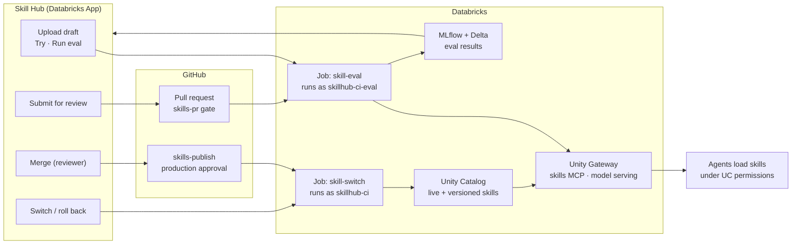

# Agent Skill Eval on Databricks

Register agent skills (`SKILL.md` bundles) in Unity Catalog, serve them to agents through Unity Gateway under Unity Catalog permissions, and evaluate every skill version against any set of models. The evidence is kept in MLflow and Delta, in your own account.

It answers five questions for every skill before it reaches users:

1. Does it fire when it should, and only then?
2. Does it make the answer better than the same model without it?
3. On which models?
4. Who can use it?
5. Which version is live, and can we go back?

**Status:** first release. Unity Catalog skills and the Unity Gateway skills MCP are **Beta** features of Databricks. The version layer, the evaluation engine, the CI/CD gates and the Skill Hub app are part of this repository. See [Beta features](#beta-features).

## Contents

- [What you get](#what-you-get)
- [How it fits together](#how-it-fits-together)
- [Using it](#using-it)
- [Deploy it in your workspace](#deploy-it-in-your-workspace)
- [Configure it](#configure-it)
- [Operate it](#operate-it)
- [Develop locally](#develop-locally)
- [Repository layout](#repository-layout)
- [Documentation](#documentation)

## What you get

- **A skills registry in Unity Catalog.** Common skills and department skills are Unity Catalog securables, granted to groups like tables. Each release is an immutable version (`<dept>_versions.<skill>-v<N>`). A switch copies a version into the live skill (`<dept>.<skill>`), so rollback is one step and old versions are never deleted.
- **Skill evaluation.**
  - **Trigger:** does the agent pick the skill when it should, and leave it alone for near-misses and unrelated requests? Accuracy, precision and recall per skill and model.
  - **Effectiveness:** is the answer better with the skill than without it? A panel of MLflow judges scores both answers against a rubric. The difference is the *uplift*.
  - Every result is tied to the exact content hash, rubric and test cases. Every score links to the MLflow trace that earned it.
- **CI/CD gates in GitHub Actions.** A pull request that changes a skill is evaluated automatically, and a failed trigger eval blocks the merge. A named reviewer approves each release in a GitHub environment before CI publishes it.
- **The Skill Hub**, a Databricks App, governed by each user's own Unity Catalog permissions. In it you can:
  - browse the catalog;
  - try a skill with and without it;
  - upload a draft, run an evaluation, and submit the draft for review;
  - follow its release, merge it (reviewers), and switch or roll back versions;
  - read the Eval matrix and a Dashboard.
- **Results as data.** Evaluation runs and cases are Delta tables in your catalog, with views, a Genie space, four SQL alerts and a nightly re-evaluation of every live skill.

## How it fits together



Three identities keep the duties apart:
- `skillhub-ci-eval` runs evaluations and can't publish.
- `skillhub-ci` publishes and switches. Its secret lives only in GitHub's `production` environment.
- The Skill Hub app's service principal starts the Jobs on behalf of users, and never publishes.

See [docs/architecture.md](docs/architecture.md) for the components, the data flow and the permission model.

## Using it

### Roles

| Role | Group | What they do |
|---|---|---|
| Reader | `skillhub-users` (common) or the department group, for example `dept-equity-research` | Their agents load the skills they can read. They browse and try skills in the Skill Hub. |
| Author | `skillhub-authors` | Upload drafts, try and evaluate them, and submit them for review. Change skills through pull requests. |
| Reviewer | `skillhub-reviewers` | Review generated test cases and rubrics, merge pull requests from the Hub once their gate passes, and switch versions. They see every department. |
| Release approver | The required reviewers of the GitHub `production` environment | Approve each release. This is a GitHub setting, not a Databricks group. |

The Skill Hub's **Access** page shows the full table with your own roles marked; [docs/onboarding.md](docs/onboarding.md) has the same table.

### The life of a skill

| Step | Where | What happens behind it |
|---|---|---|
| 1. **Upload draft** | Skill Hub → Catalog → Upload draft | The app checks the upload with the same lint as CI and stores it privately in the workspace. Only the uploader and reviewers can see it. |
| 2. **Try this skill** | The draft's page | The app stages the draft in a temporary schema that only you can read, runs the agent as you with and without the skill, and drops the schema. One MLflow trace. |
| 3. **Run eval** | The draft's page → Run eval | The Databricks Job `skill-eval` runs every test case × model × 3 repeats and writes the results to `<dept>_evals`. They appear on the draft's page. |
| 4. **Submit for review** | The draft's page | The app opens a pull request with the skill under `skills/<dept>/<skill>/`. The skill is now a *candidate*. |
| 5. **Eval gate** | GitHub, automatic | `skills-pr` evaluates the candidate on the default models and posts a "Skill evaluation" comment. A failed trigger eval blocks the merge. |
| 6. **Merge** | Skill Hub (reviewers) or GitHub | `skills-publish` checks the merged content's results. It reuses the gate's when only the skill changed and the content is identical, else it evaluates again. Then it waits for approval. A merge to `main` also starts the `platform` deploy, which asks for its own `production` approval. |
| 7. **Approve** | GitHub → the run → Review deployments → `production` | The Job `skill-switch` creates the next version, switches it live and records who did it. Approve the `platform` run the same way, so the merged code is deployed. |
| 8. **Live** | Everywhere | Agents with read access load it through Unity Gateway. The Skill Hub's **Release path** panel shows each step as it happens. |

Rollback is a **Switch version** on the skill's page (reviewers): pick the version, compare the two in the matrix, confirm. It runs the same `skill-switch` Job.

### Write a skill

A skill is a folder: `SKILL.md` (with `name` and `description` frontmatter), optional `references/`, and an `evals/` folder:
- `evals.json` holds the test cases:
  - positive cases;
  - near-misses that name the sibling skill that should take them;
  - unrelated requests;
  - optional effectiveness cases with fixtures and assertions.
- `rubric.json` holds the effectiveness criteria. `uv run skillhub generate --skills <name>` drafts both. A reviewer then checks them and marks them reviewed. Only reviewed cases gate a release.

[docs/onboarding.md](docs/onboarding.md) walks through it, including how to import a whole skill repository.

### Connect your own agents

Agents outside the Skill Hub load skills from the Unity Gateway skills MCP (Beta), with the user's identity, so Unity Catalog grants apply. A connection offers at most 20 per-skill tools in this Beta, so add one MCP server per schema, for example one for the department and one for `common`. `src/skillhub/gateway/skills_mcp.py` is a reference client. The Skill Hub also has a REST API; see [docs/api.md](docs/api.md) and `/docs` on the app.

## Deploy it in your workspace

### Prerequisites

- A Databricks workspace with:
  - Unity Catalog, and a catalog you own;
  - a SQL warehouse;
  - serverless Jobs;
  - Databricks Apps;
  - Model Serving endpoints for the models you want to compare. The shipped config uses the Foundation Model API endpoints for Claude, GPT and Gemini.
- The Unity Catalog skills and Unity Gateway skills MCP Beta features enabled on the workspace.
- A workspace admin who owns the catalog, for the first bootstrap.
- A GitHub repository with Actions, environments and branch protection. On GitHub Free, these need a public repository.
- A self-hosted runner if the workspace has an IP access list, because GitHub-hosted runners use changing addresses. See [Network access from CI](docs/operations.md#network-access-from-ci).
- Locally: Python 3.11 or later with [`uv`](https://docs.astral.sh/uv/) (CI and the commands below use 3.12), the Databricks CLI (v1.20 or later), the GitHub CLI `gh`, and Node.js 20 or later for the app's frontend.

### Steps

[docs/operations.md](docs/operations.md) has the details for each step. The first deploy takes two passes. The deploy creates the Skill Hub app, and with it the app's service principal. So pass 1 uses the `skillhub-ci` application ID as a stand-in for the app's, and pass 2 replaces it.

**Pass 1: set up and deploy**

1. **Make the repository yours.** Create your own repository from this one. Edit `config/hub.yaml`: your departments and their reader groups, your model endpoints, and your thresholds. See [Configure it](#configure-it). Replace or import the skills under `skills/`. The unit tests check the shipped example skills, so update the tests that name them in the same change (see [Import another skill repository](docs/onboarding.md#import-another-skill-repository)). Otherwise the `platform` check fails, and nothing deploys. Deploy and eval runs before step 5 fail, because GitHub is not configured yet. That is expected.
2. **Run the first bootstrap, as a person.** You must own the catalog and be a workspace admin. Sign in with the Databricks CLI, for example `databricks auth login --host <workspace URL>`. Set `SKILLHUB_CATALOG`, `SQL_WAREHOUSE_ID` and `SKILLHUB_WORKSPACE_ROOT` (`/Users/<skillhub-ci application ID>/skill-hub`). Leave `SKILLHUB_APP_PRINCIPAL` unset, because the app does not exist yet. Then run:
   ```bash
   uv run skillhub bootstrap --create-identities --secret-out ci-secret.txt --eval-secret-out ci-eval-secret.txt
   ```
   It creates:
   - the account groups and the two CI service principals;
   - the schemas and grants, the results tables and views, and the experiment folders with locked-down access lists;
   - the prompts, the judges, the SQL alerts and the Genie space.

   The workspace root sits in `skillhub-ci`'s home folder, so its ID must be known first. If `skillhub-ci` doesn't exist yet, create the two service principals in Settings → Identity and access → Service principals, named `skillhub-ci` and `skillhub-ci-eval`. Bootstrap uses existing principals by name.

   It writes each new OAuth secret to the file you name (mode 0600) and never prints one. It prints the application IDs of both CI principals. It warns that the app gets no grants; pass 2 gives them. `--print-identities` lists what it would create, for an admin to do by hand. [Bootstrap](docs/operations.md#bootstrap) explains the order and what to do when the workspace refuses an API call.
3. **Grant one role by hand.** `skillhub-ci` needs the **Service Principal User** role on `skillhub-ci-eval` before the first production deploy. See [Service Principal User role](docs/operations.md#service-principal-user-role).
4. **Configure GitHub.** Run `scripts/configure_github.sh`. Give both `--app-principal` and `--app-principal-dev` the `skillhub-ci` application ID, as the stand-in. The script:
   - creates the `ci-eval` and `production` environments with their secrets and variables, and names the release approver;
   - protects `main` (the `skills-pr` and `platform` checks must pass, and branches must be up to date).

   It reads every secret from a file and never prints one. Besides the two secret files from step 2, it reads the workspace URL, the warehouse ID and each CI application ID from files. See [Secrets](docs/operations.md#secrets). Keep the files, with mode 0600, until setup is complete: the script needs all of them on every run.
5. **Deploy.** Push to `main`, for example your changes from step 1, or run `gh workflow run platform.yml --ref main -f deploy=prod`. Then approve the `production` deployment: GitHub → the run → Review deployments. `platform.yml` deploys the bundle (the Jobs and the app) into the `prod` target. If the push changes `skills/`, `skills-publish` also runs and fails, because the Job IDs are not set yet. Step 11 releases the skills.

**Pass 2: connect the app**

6. **Record the app and the Jobs in GitHub.** Use the Databricks CLI sign-in from step 2:
   - `databricks apps get skill-hub -o json` shows the app's application ID as `service_principal_client_id`. `skill-hub` is the prod app name in `databricks.yml`.
   - `databricks jobs list --name skill-eval` and `databricks jobs list --name skill-switch` show the Job IDs.
   - Set the variables:
     ```bash
     gh variable set APP_PRINCIPAL --env production --repo <owner>/<repo> --body <app application ID>
     gh variable set SKILLHUB_JOB_ID_EVAL --env production --repo <owner>/<repo> --body <skill-eval ID>
     gh variable set SKILLHUB_JOB_ID_EVAL --env ci-eval --repo <owner>/<repo> --body <skill-eval ID>
     gh variable set SKILLHUB_JOB_ID_SWITCH --env production --repo <owner>/<repo> --body <skill-switch ID>
     ```
   `APP_PRINCIPAL_DEV` belongs to the dev app, `skill-hub-dev`, which exists only after a dev deploy. Set it the same way after your first dev deploy, then deploy dev again.
7. **Deploy again.** Run `gh workflow run platform.yml --ref main -f deploy=prod`, and approve it. The bundle now gives the app's principal its permissions on the `skill-eval` and `skill-switch` Jobs.
8. **Grant the app.** As the catalog owner, give the Skill Hub app's service principal `USE CATALOG` and `CREATE SCHEMA` on the catalog. Try on skills under review needs both:
   ```sql
   GRANT USE CATALOG, CREATE SCHEMA ON CATALOG <catalog> TO `<app application ID>`
   ```
   Then run the `skillhub-bootstrap` Job once: `databricks jobs run-now <ID>`, with the ID from `databricks jobs list --name skillhub-bootstrap`. It runs as `skillhub-ci` and gives the app its schema grants and folder access.
9. **Connect the Skill Hub to GitHub.** **Submit for review**, the **Release path** and **Merge** need a fine-grained GitHub token for this repository, stored as the Databricks secret `skillhub/github-token`, with READ for the app's principal. See [GitHub token for the Skill Hub](docs/operations.md#github-token-for-the-skill-hub). A GitHub App is the production choice.
10. **Add people to the groups.** Readers go into `skillhub-users` and the department groups; also fill `skillhub-authors` and `skillhub-reviewers`. Add `skillhub-reviewers` to every department's reader group too: reviewers browse and switch a department's live skills only through it. The groups are account groups assigned to the workspace.
11. **Release the first skills.** Nothing is released yet, so the first release takes every skill on `main`. Run `gh workflow run skills-publish.yml --ref main`, or merge a pull request that changes `skills/`. It evaluates the skills, waits for the `production` approval, then publishes them as v1 and makes them live.
12. **Delete the secret files.** Setup is complete. To change one variable later, use `gh variable set`. See [Change one variable](docs/operations.md#change-one-variable).

**Check it worked:**
- The Skill Hub shows your skills as live, with a verdict per model.
- **Access** shows your roles.
- **Try this skill** answers with "Skill invoked: yes".
- `uv run skillhub check-permissions`, with the variables from step 2, exits 0.

### Upgrade

Merge the new version into your repository. The `platform` workflow deploys it after the `production` approval. Then run the `skillhub-bootstrap` Job once, so the tables, views, alerts, prompts and experiment folders match the new code.

## Configure it

Everything customer-specific is in `config/hub.yaml`. `${VAR}` values come from the environment; nothing in it is secret.

| Key | What it sets |
|---|---|
| `catalog`, `workspace_root` | The catalog for every schema, and the workspace folder for experiments, CI candidates and drafts. Never use `/Shared`: every user can edit it. |
| `departments` | One key per folder under `skills/`, with its reader groups. `common` is read by everyone. `quarantine: true` makes a department reviewer-only. Its skills are evaluated in pull requests but never published. `external` is quarantined, for partner-built skills. |
| `roles` | The author, reviewer and CI group or principal names |
| `models` | Model profiles: a name, a serving endpoint and a class. Add your own endpoints here. |
| `judges`, `judges_pr`, `generator` | The judge panel for full runs, the single judge for pull request runs, and the model that drafts test cases and rubrics. |
| `defaults` | The default models and repeats, the verdict thresholds, `min_reviewed_cases`, the concurrency, and `gating_modes`, the modes whose verdicts block a release. |
| `import` | A pinned upstream skill repository and how its folders map to departments. |

**Verdicts:**
- **Pass** at a pass rate ≥ `warn_rate` (0.8), **Warn** at ≥ `fail_rate` (0.5), **Fail** below that.
- **Inconclusive** when more than `max_error_rate` (10%) of runs errored.
- **Advisory** with fewer than `min_reviewed_cases` (5) reviewed cases; it never blocks.
- The Eval matrix explains these on the page.
- A skill can only tighten the thresholds, never loosen them.

## Operate it

- **Nightly:** the Job `skillhub-nightly` (02:00 UTC) re-evaluates every live skill. It also checks for drift between the journal and the live skills and for permission drift, and cleans up old run schemas, candidates and drafts.
- **Alerts:** four SQL alerts: a verdict regression, the error rate, inconclusive runs, and a failed switch. Set their destination with `gh variable set SKILLHUB_ALERT_DESTINATION_ID --env production --repo <owner>/<repo> --body <destination ID>`, then deploy prod and run the `skillhub-bootstrap` Job. See [SQL alerts](docs/operations.md#sql-alerts).
- **Switch and rollback:** from the Skill Hub (reviewers), or with the `skills-switch` workflow. Every switch is journaled with who did it.
- **A release that failed outside the eval** (for example, the runner lost the workspace), **or a release or deploy that shows as Cancelled:** releases, prod deploys and switches wait in one queue. A newer run replaces an older one that is still waiting, and GitHub shows the older one as Cancelled. Nothing is lost, but nothing starts it again by itself. Start a release again with `gh workflow run skills-publish.yml --ref main`. It picks up every unreleased change and still waits for approval. Start a prod deploy again with `gh workflow run platform.yml --ref main -f deploy=prod`. See [Replaced runs](docs/operations.md#replaced-runs).
- **Results:** query the views in each department's evals schema, for example `<catalog>.dept_equity_research_evals` (`common_evals` for `common`), or, for reviewers, the cross-department views in `<catalog>.eval`. Or ask the Genie space.

[docs/operations.md](docs/operations.md) covers each of these, plus retiring skills, quarantine and break-glass commands.

## Develop locally

```bash
uv venv --python 3.12
uv sync --frozen
uv run --frozen skillhub lint                 # check every skill bundle
uv run --frozen pytest -q                     # unit tests
(cd app/frontend && npm ci && npm test)       # Skill Hub frontend tests
uv run --frozen skillhub --help               # the CLI: generate, eval, sync, publish, switch, ...
```

`scripts/build_app.sh` builds the frontend and stages the app's code for a deploy; the `platform` workflow runs it before each deploy.

## Repository layout

| Path | Contents |
|---|---|
| `skills/` | Skill bundles by department, with their evaluation cases and rubrics |
| `config/hub.yaml` | Deployment settings: catalog, departments, model profiles, thresholds |
| `src/skillhub/` | Python package and `skillhub` CLI |
| `app/` | Skill Hub app (FastAPI backend, React frontend) |
| `resources/`, `databricks.yml` | Databricks bundle: the Jobs and the app |
| `.github/workflows/` | CI/CD: `platform` (tests and deploys), `skills-pr` (the gate), `skills-publish` (release), `skills-switch` (manual switch) |
| `docs/` | Architecture, operations, API and onboarding guides |
| `fixtures/` | Synthetic test data for evaluations, with the Northwind Robotics suite |
| `scripts/` | Helpers: `configure_github.sh`, `build_app.sh`, `mark_reviewed.py`, `wait_job_run.sh` |

Example skills are imported from [anthropics/financial-services](https://github.com/anthropics/financial-services) under the Apache-2.0 license; see `THIRD_PARTY_NOTICES`.

## Beta features

- **Unity Catalog skills** and the **Unity Gateway skills MCP** are Beta. A skills MCP connection offers at most 20 per-skill tools. This product opens one connection per schema, and `skillhub lint` rejects a department with more than 20 skills.
- **Effectiveness** is reported but doesn't gate releases by default (`gating_modes: [trigger]`), while its strict assertions are tuned. Add `effectiveness` to gate on it.
- **CI credentials:** CI uses OAuth machine-to-machine secrets in GitHub environments. OIDC federation and a GitHub App for the Skill Hub are planned.

## Documentation

- [docs/architecture.md](docs/architecture.md): components, data flow, Unity Catalog layout, permissions, versions and switch, the evaluation method, results.
- [docs/operations.md](docs/operations.md): bootstrap, identities, secrets, deploy, running evals, switch and rollback, alerts, nightly.
- [docs/onboarding.md](docs/onboarding.md): roles, adding a skill, evaluating a new skill, drafts and Submit for review, importing a skill repository.
- [docs/api.md](docs/api.md): the Skill Hub REST API and the Databricks API equivalents.

## License

Apache-2.0; see `LICENSE`.
