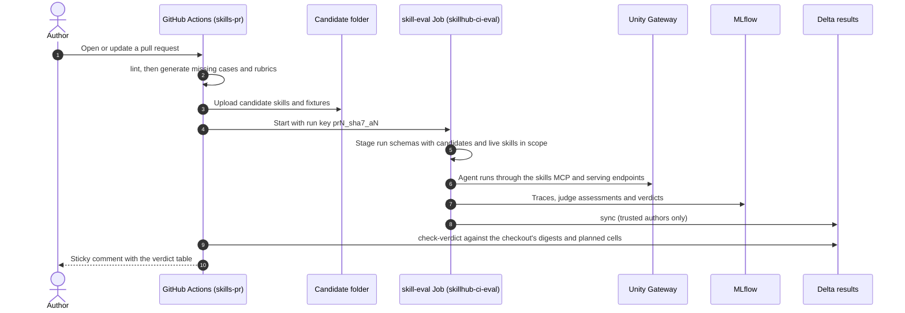
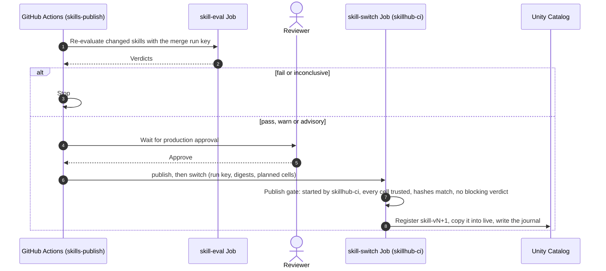
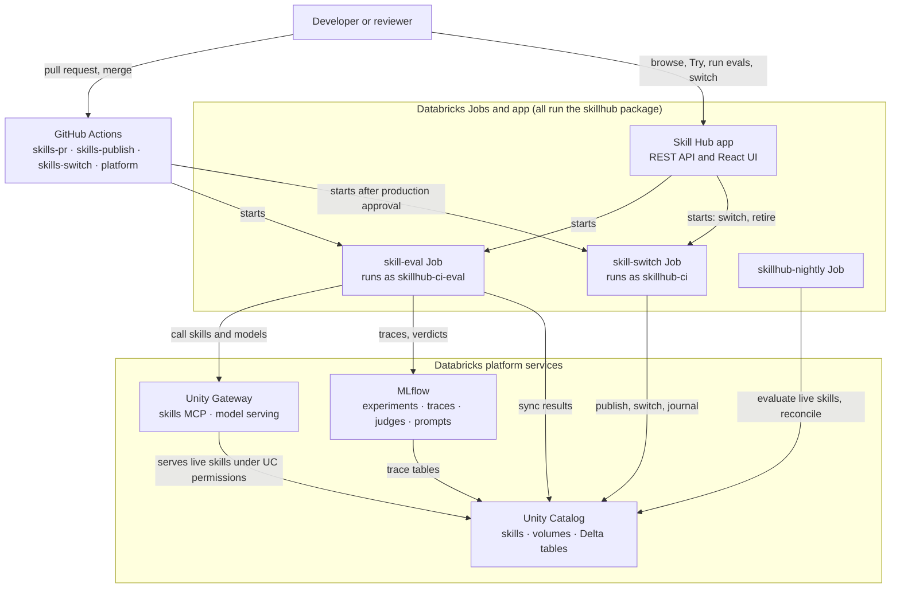

# Architecture

Skill Hub manages agent skills (`SKILL.md` bundles) as Unity Catalog objects. It publishes versions, serves the live version through the Unity Gateway under Unity Catalog permissions, and evaluates each version against any set of models. Results are kept in MLflow and Delta.

## Components

| Component | Role | Databricks feature |
|---|---|---|
| `skillhub` package and CLI | Registry, versions, eval engine and results sync. The same code runs in CI, in Jobs and in the app. | Python package |
| Jobs `skillhub-bootstrap`, `skill-eval`, `skill-switch`, `skillhub-nightly` | Set up the workspace, run evals, switch versions, run nightly checks | Declarative Automation Bundle, Jobs |
| Skill Hub app | FastAPI REST API and React UI | Databricks Apps |
| Skills, schemas, volumes and Delta tables | Storage and permissions | Unity Catalog |
| Skills MCP server (Beta) and model serving endpoints | Agents discover and load skills; models are called | Unity Gateway |
| One experiment per skill, traces, judges, prompts | Evidence and scoring | MLflow 3 (tracing, `make_judge`, Prompt Registry) |
| `skills-pr.yml`, `skills-publish.yml`, `skills-switch.yml`, `platform.yml` | CI/CD pipelines | GitHub Actions |
| Alerts over the result tables | Notification | SQL alerts |
| Natural-language questions over the eval tables | Exploration | Genie space |

## Data flow

There are two flows.

**Pull request.** CI runs `lint`, then `generate` for skills that lack test files (a bot commits them). CI uploads the checked-out `skills/` and `fixtures/` folders to a candidate folder scoped to the run (`<workspace_root>/<catalog>/candidates/<run key>`), then starts the `skill-eval` Job with a run key such as `pr12_ab12cd3_a1` (`pr<N>_<sha7>_a<attempt>`). The run stages its own `run_<key>_<schema_base>` schemas, which hold the candidate skills and the live skills in scope. Configuration always comes from the deployed bundle, never from the pull request. The Job evaluates, then runs `sync`. CI then posts a sticky pull request comment with the run key and the verdict table. The comment has no hosts or IDs unless the repository variable `SKILLHUB_PR_LINKS` is `true`. The gate (`check-verdict --expect-file`, fed by `skillhub eval-digests` on the checkout) passes only if every planned gating cell (each model times `trigger` and `with_skill`) has a trusted row, and every gating row evaluated exactly the content, the rubric, and the cases with their fixtures of the checkout.

**Merge to `main`.** CI re-evaluates every changed skill that still exists on every merge. Changed means changed since the `skillhub/released` tag, which a release moves when it finishes, so the next merge picks up a release that failed or was rejected. Before the first release there is no tag, and every skill counts as changed. A change that moves a skill out of a quarantined department stops here: an operator must handle it. A `fail` or `inconclusive` verdict stops the run. `warn`, `advisory` and `pass` go on to approval in the `production` environment. After approval, CI starts the `skill-switch` Job (`publish`, then `switch`), which registers `<skill>-v<N+1>` in the versions schema and makes it live, and writes the journal. CI never registers a version itself; publishes run only in the `skill-switch` Job.

**Publish gate.** Published content equals evaluated content, and the eval read the merged cases. The publish step takes the run key of the merge eval and the plan's eval digests and cells. It refuses, exits with code 2 and journals `publish_refused` unless all of these hold:

- `skillhub-ci` started the `skill-switch` Job run. The app may switch and retire, never publish.
- Every planned cell has a trusted row.
- The rows were computed on exactly the bundle being published, with the merge's rubric (`rubric_hash`) and cases and fixtures (`dataset_digest`).
- None of the latest trigger or with-skill verdicts blocks it.

**Deleting a skill folder.** A merge that deletes `skills/<dept>/<name>/` retires the skill. After the `production` approval, CI starts the `skill-switch` Job with `action=retire`.

## Unity Catalog layout

| Schema | Holds | Grants |
|---|---|---|
| `<d>` | Live skills. | `READ VOLUME` at schema level, inherited by every skill in it, for the department's readers |
| `<d>_versions` | Every published version, as `<skill>-v<N>`. | Authors and reviewers |
| `<d>_evals` | OTel trace tables, `eval_runs`, `eval_cases`, `skill_versions`, evaluation datasets `ds_<skill>` (they mirror `evals.json` for lineage and the Skill Hub; scoring never reads labels from them), `rubrics` (insert-only, one row per rubric per run) and the `eval_matrix` view. | `SELECT` for readers, reviewers and both CI principals. Table-level `MODIFY`: `skillhub-ci` on `skill_versions`; `skillhub-ci-eval` on `eval_runs`, `eval_cases`, `rubrics` and the trace tables, plus `CREATE TABLE` for the `ds_<skill>` tables |
| `eval` | The `matrix_all`, `runs_all`, `cases_all` and `versions_all` views across departments. | Reviewers |
| `run_<key>_<schema_base>` | Temporary schema for one eval run. | `skillhub-ci-eval` only. Dropped when the run ends; a cleanup Job drops any older than 24 hours. |

Bootstrap creates all schemas. `ensure_tables` and `ensure_views` create none. After the first bootstrap, `skillhub-ci` owns the schemas, tables and views.

Here `<d>` is the department schema: `common`, `external` or `dept_<key>`. The reader groups for each department are named in `config/hub.yaml`.

Naming rules:

- The skill ID is the folder name, and the frontmatter `name` must match it.
- Versions are `<d>_versions.<skill>-v<N>`.
- Skill bundles hold `SKILL.md` and its reference files only. Test cases and rubrics are never uploaded to a skill bundle, because the agent under test could read them through its skills tools.

## Permission model

| Action | Authorised by |
|---|---|
| Browse skills | The Unity Catalog Skills API, called with the signed-in user's token |
| See results | `SELECT` on `<d>_evals`, with the user's token, through the SQL warehouse |
| Try a skill | The agent loop runs with the user's token, so only the user's own skills are offered. The app service principal writes the traces to the skill's experiment. Each trace has a `hub_try` root span and the tags `trigger_source=hub-try`, `mode` and `requested_by`. A Try request that runs longer than 180 seconds answers 504 `try_timeout`, and the next Try can start at once. |
| Run an eval | The app checks that the user can read every requested skill, then starts `skill-eval` as the app's service principal and records who requested it |
| See or evaluate a candidate | The user must be in the authors or reviewers group. Reviewers see every department; an author sees a department only when the effective-permissions API shows `USE CATALOG`, `USE SCHEMA` and `READ VOLUME` on its live schema for the user. The uploader of a draft always sees it. Only then does the app read the candidate or draft folder as its service principal. Eval rows are read with the user's token |
| Upload a draft | The user must be an author or reviewer, and an author may upload only to a department they can read. The app checks the upload as `skillhub lint` does and stores it in `<workspace_root>/<catalog>/drafts` as its service principal. A draft is never published: publish accepts only rows of the merge eval (`trigger_source` `merge`) |
| Switch a version | The app checks that the user is in the reviewers group, then starts `skill-switch` as the app's service principal |

- Only `skillhub-ci-eval` and the app service principal may run `skill-eval`. Only `skillhub-ci` and the app service principal may run `skill-switch`, and a publish runs only in a `skill-switch` run that `skillhub-ci` started. Users cannot start these Jobs directly.
- If a check cannot be made, the request is refused (fail closed).
- If user authorisation does not cover the skills API in a workspace (the user-token call answers permission denied), the app lists skills as its service principal and filters them with the effective-permissions API for the signed-in user. After a fallback "yes", the app reads the skill files as its service principal. That principal therefore needs `READ VOLUME` on the live skill schemas and access to the effective-permissions API. If the fallback also fails, browsing is refused.
- The app is open to the group `users` (`CAN_USE`).
- A quarantined department (`quarantine: true`) is granted to reviewers and the two CI principals only. Moving a skill out of it needs an operator; CI refuses the change.
- Experiment permissions are derived from the grants on `<d>_evals`. The experiment folder `<workspace_root>/<catalog>` has its own access list: `CAN_MANAGE` for `skillhub-ci`, `CAN_EDIT` for `skillhub-ci-eval` and the app (Try traces), `CAN_READ` for reviewers, nothing for `users`. Its `candidates/` folder adds `CAN_MANAGE` for the two CI principals, and its `drafts/` folder adds `CAN_MANAGE` for them and the app. The workspace root is the home folder of `skillhub-ci` (`/Users/<ci principal>/skill-hub`), because every folder under `/Workspace/Shared` inherits `CAN_MANAGE` for `users`. A nightly check reports drift.
- Results are trusted by author. Sync and every gate read only MLflow runs written by `skillhub-ci-eval`, the deployer or the running identity. The app service principal is not trusted; it never writes eval runs. `eval_runs.run_author` records the author. Databricks does not return a server-side author for a run, so the author comes from the MLflow `mlflow.user` tag, which the client sets. The tag is only as trustworthy as write access to the experiments, which bootstrap limits to the CI and app principals.
- Results are also trusted by where each field is written. Sync reads runner tags only from tags and runner params only from params, and skips a run where a runner field appears in the other place.

## Versions and switch

- **Content hash.** The hash is SHA-256 over every file in the bundle except `evals/`, in sorted path order. Publishing identical content does nothing. Version numbers only increase.
- **Test cases and rubrics.** They are never uploaded to the skill bundle and do not create a skill version. The gates bind them separately: `rubric_hash` covers `rubric.json`, and `dataset_digest` covers the `evals.json` bytes and the bytes of every fixture its cases use (their `fixtures`, the search indexes, and the planted-bug manifest for the planted workbook).
- **Single writer.** CI and the Skill Hub publish, switch and retire only through the `skill-switch` Job (`skillhub job-switch`). The Job has `max_concurrent_runs: 1` with queueing, so two changes never interleave. The operator commands `skillhub switch` and `skillhub retire` bypass the queue and the approval. Use them only when the Job is unavailable (break-glass).
- **Publish gate.** `job-switch --action publish` refuses unless `skillhub-ci` started the Job run and the eval for its run key evaluated exactly this content and these eval inputs in every planned cell (see Data flow). A refusal journals `publish_refused`.
- **Steps.** Before any file is touched, the Job journals `switch_started`. It then uploads the changed reference files, uploads `SKILL.md`, deletes files that are not in the target version, finalises, reads the files back and compares hashes (one attempt and up to three retries). It ends by writing `switched` or `switch_failed`.
- **Which version is live.** Only a `switched` row makes a version live. A `published` row does not. A later `retired` row ends it.
- **Limitation.** File uploads take effect as they happen. For a few seconds during a switch, an agent can see a mix of old and new files.
- **Reconcile.** `skillhub reconcile` runs nightly and at the start of every switch. It alerts on hash drift, an unfinished switch and files changed after the last finalise. A `switch_failed` row also fires the `switch-failed` SQL alert. It never repairs anything by itself.
- **Pinning.** A pin is `dept/name=N`, so the same skill name can be pinned in two departments. A team that needs a fixed version gets `READ VOLUME` on `<d>_versions.<skill>-v<N>` and loads it by name.
- **Events.** Each publish, switch and retire writes a row to `skill_versions`, so a Databricks Job can subscribe with a table update trigger. Webhooks are planned.

## Evaluation method

**Trigger tests** run on every skill.

- Each case is one model call. A skill tool call counts as invoked.
- The outcome is `correct`, `correct_reject`, `wrong_skill`, `missed` or `false_trigger`, found by comparing with the expected skill.
- Generated cases per skill: about 8 positive, about 4 near-misses aimed at sibling skills in the same scope, and about 3 unrelated.
- Accuracy, precision, recall and a confusion matrix are reported over the skills in scope.

**With-versus-without runs** for effectiveness cases.

- The same model and the same fake tools run with and without the skills server. Only the skills server differs.
- Skill content never goes into a prompt. The agent discovers and loads the skill itself.
- Uplift is reported separately for `task_quality` (would a domain expert want this anyway) and `skill_format` (the skill's own conventions).

**Scoring.**

- Code scorers read the tool spans of the trace.
- `ExpectationsGuidelines` checks each case's assertions.
- One `make_judge` per rubric criterion uses only inputs and outputs. A `make_judge` with the trace checks skill use. Built-in tool-call and safety scorers run on effectiveness cases.
- Judges form a panel (`judges`, which by default is every configured judge model; PR runs use `judges_pr`). Every judge's assessment is kept. A criterion passes only with a strict majority of the whole configured panel, for example 2 of 3. If at least one judge answered but there is no such majority, the criterion is not met. If no judge answered, the criterion is an error. Judge prompts mark the agent output and the skill text as data and tell the judge to ignore instructions inside them. Bootstrap registers only the skill-use judge of the first judge model. The rest of the panel runs at eval time.
- Verdict rules: a pass rate below `fail_rate` is `fail`; below `warn_rate` is `warn`; otherwise `pass`. An error rate above `max_error_rate`, or most of the panel not responding, is `inconclusive`. Fewer than `min_reviewed_cases` reviewed cases is `advisory` and does not gate. Only reviewed cases count toward a gating verdict. A reviewed case with no dataset row counts as an error.
- Thresholds: a skill may set its own `fail_rate`, `warn_rate` (`evals.json`) and `pass_score` (`rubric.json`), but only to tighten the defaults in `config/hub.yaml`. A looser value is ignored with a warning, and lint reports it. `max_error_rate` and `min_reviewed_cases` are not per skill.
- Repeats: each case runs `repeats` times (default 3).
- Concurrency: one eval run evaluates up to `skill_workers` skills at once, each in its own worker process. In a process, child runs run one at a time: the models of a skill run one after another, each with its modes in order (`trigger`, `without_skill`, `with_skill`). A child run makes one `evaluate` call over all its repeats: each case appears `repeats` times, and each copy gets its own repeat number on the trace. That `evaluate` predicts up to `concurrency_per_endpoint` records at once. Each skill starts on a different model of its list, by its place in the run, so skills that start together use different endpoints first.
- Why processes, and one `evaluate` at a time: MLflow keeps some tracing state per process. `set_experiment` resets the process's trace destination. A new trace is linked to the newest active run of any thread, and `mlflow.genai.evaluate` keeps one evaluation context per process. Two child runs active at once in one process would take each other's traces. Two `evaluate` calls at once in one process, even for the same run, deadlocked inside MLflow. With more than one repeat, the records are passed as plain records, so MLflow does not link the run to the dataset object.
- Model profiles declare a class (`frontier` or `fast`), shown next to results.
- The harness does not send `temperature`, because the supported models reject it. Repeats give a measure of consistency instead.
- Fixtures: all tools are fake and the data is synthetic (the Northwind Robotics fixture suite), so runs are repeatable and need no live web access.
- Rubrics: 5 to 10 criteria per skill, each with a `source` that points to the part of `SKILL.md` it came from. They are reviewed in pull requests like any other change. Each run writes the rubric to the `rubrics` table, not to the skill bundle.

## Results

MLflow is the source of truth. Delta is synced from it.

- One experiment per skill (`<workspace_root>/<catalog>/<dept>/<skill>`), bound at creation to the department's trace tables.
- One parent run per department for each eval, keyed by `run_key`. Child runs for each skill version, model profile and mode sit under it.
- Child runs carry params (`skill_fqn`, `skill`, `dept`, `skill_version`, `content_hash`, `rubric_hash`, `dataset_digest`, `model_profile`, `endpoint`, `model_class`, `mode`, `judges`, `prompt_versions`, `git_sha`, `trigger_source`, `requested_by`, `run_key`, `repeats`), tags (`run_key`, `parent_run_id`, `harness`, `verdict`, `error`, `rubric_stale`) and metrics (`pass_rate`, `spread`, `error_rate`, accuracy, precision, recall, uplift by type, `pass_rate_without`, and `planted_bugs_recall` where it applies).
- `skillhub sync --run-key <key>` reads each run back from MLflow and inserts missing rows into `eval_runs` and `eval_cases`. It never updates or deletes rows. It skips runs by untrusted authors, runs with a runner field in the wrong place (for example a `verdict` param), runs whose department differs from their experiment's, and runs in badly named experiments, with a warning.
- **Harness.** `eval_runs` has a `harness` column. The built-in agent loop is `reference`, and it is the only harness in this release. Other harnesses come later. The matrix, the alerts and the Skill Hub show the column.
- `eval_matrix` shows the latest run per skill, version, model profile and mode. It carries the verdict, `n_reviewed` and `n_cases`, and the experiment ID so the UI can link to MLflow. The cross-department matrix shows `dept`.
- The SQL alerts and the Genie space read these tables.
- Retention: product code never deletes rows. Delta time travel is not an audit trail.
- OpenTelemetry: traces are stored as OTel-shaped Delta tables in the customer's Unity Catalog account. The Unity Gateway unified trace table (Beta, enabled per workspace) can record skill usage across the workspace when it is available.

## Beta features and limitations

- **UC Skills (Beta).** Skills are stored and served as Unity Catalog objects. There is no native versioning, so this product keeps the versions.
- **Skills MCP server in Unity Gateway (Beta).** Agents use it to discover and load skills. The client is isolated in one module of the package, so a change to the service touches one file.
- **Unified trace table (Beta).** Optional.
- **Production monitoring (Beta).** Not used in this release. The nightly Job provides re-evaluation.
- **Compliance Security Profile.** Workspaces with this profile block skill writes, so skill publishing is not supported there.
- **External skills.** Skills in the `external` department are readable by reviewers only, and nothing from that department can be released in this release.
- **Reviewed cases.** Generated cases are advisory until a member of the reviewers group marks them reviewed.
- **Planned for later releases (not in this release):** authoring in the Skill Hub through pull requests, security scanning before release, approve-and-publish in the app, external agent evaluation, GitHub OIDC federation, judge alignment, webhooks, and model routing through the Unity Gateway for Claude.
