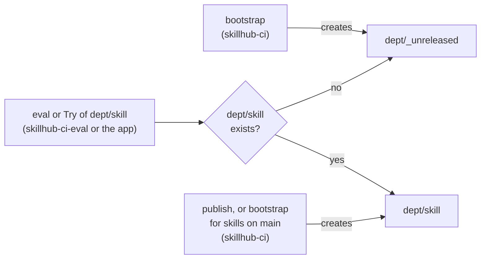

# Operations

## Bootstrap

Prerequisites: a workspace with Unity Catalog and a SQL warehouse, serverless jobs, Python 3.11 or later with `uv`, and a GitHub repository. The floor is 3.11 (`requires-python` in `pyproject.toml`), because the Skill Hub app runs on the Python of the Databricks Apps runtime, which is 3.11. CI and the commands in this guide use Python 3.12.

Follow this order. The first deploy takes two passes, because the deploy creates the Skill Hub app, and with it the app's service principal. Until pass 2, the `skillhub-ci` application ID stands in for the app's.

1. **A person runs the first bootstrap.** Set `SKILLHUB_CATALOG`, `SQL_WAREHOUSE_ID`, and `SKILLHUB_WORKSPACE_ROOT` to the folder for the experiments and CI candidates, normally `/Users/<skillhub-ci application ID>/skill-hub`. Leave `SKILLHUB_APP_PRINCIPAL` unset: the app does not exist yet, so bootstrap warns and skips the app's grants. Then run `uv run skillhub bootstrap --create-identities --secret-out <file> --eval-secret-out <file>`. The person must own the catalog and be a workspace admin. Without `SKILLHUB_WORKSPACE_ROOT` the folder is `/Shared/skill-hub`, which every user can edit (see [Experiment folders](#experiment-folders)).
2. **Grant one role by hand.** `skillhub-ci` needs the Service Principal User role on `skillhub-ci-eval`. Do this before the first prod deploy. See [Service Principal User role](#service-principal-user-role).
3. **Configure GitHub.** Run `scripts/configure_github.sh` (see [Secrets](#secrets)). Give `--app-principal` and `--app-principal-dev` the `skillhub-ci` application ID as the stand-in. This is safe: bootstrap gives no app grants to a principal that is a CI principal, and the bundle accepts `skillhub-ci` twice on the `skill-switch` Job.
4. **Deploy (pass 1).** Push to `main`, or run `gh workflow run platform.yml --ref main -f deploy=prod`. Then approve the `production` deployment. The deploy creates the Jobs and the app (see [Deploy](#deploy)).
5. **Replace the stand-in (pass 2).**
   1. Read the app's application ID: `databricks apps get skill-hub -o json`, field `service_principal_client_id`. The app names are `app_name` in `databricks.yml`: `skill-hub` for `prod`, `skill-hub-dev` for `dev`.
   2. Set it: `gh variable set APP_PRINCIPAL --env production --repo <owner>/<repo> --body <application ID>`. Record the Job IDs at the same time (see [Change one variable](#change-one-variable)).
   3. Deploy prod again: `gh workflow run platform.yml --ref main -f deploy=prod`, then approve it.
   4. The dev app exists only after a dev deploy. After the first one, set `APP_PRINCIPAL_DEV` from `skill-hub-dev` in the same way, and deploy dev again.

   Finish pass 2 before the nightly run at 02:00 UTC. With the stand-in, `skillhub-ci` counts as the app, so `check-permissions` reports its access from its home folder as `inherited_access`.
6. **Grant the app, then run the bootstrap Job.** Give the app's principal `USE CATALOG` and `CREATE SCHEMA` on the catalog (see [Try on skills under review](#try-on-skills-under-review)). Then run the `skillhub-bootstrap` Job once. It runs as `skillhub-ci` and gives the app its schema grants, trace-table access and folder access. Run it again after every upgrade, so the tables, views, alerts and prompts match the new code.

What the first run does:

- It creates the account groups and the two CI service principals if they are missing.
- It creates the schemas, applies the grants from `config/hub.yaml`, creates the tables and views, and creates the experiment folders with their access lists. It creates an experiment for each skill on `main` and an unreleased experiment for each department (see [Experiments of new skills](#experiments-of-new-skills)).
- It registers the prompts and the skill-use judge (see below).
- It creates or updates the SQL alerts and the Genie space.
- It gives `skillhub-ci-eval` `CAN_USE` on the SQL warehouse, and `skillhub-ci` `CAN_MANAGE`: the deploy binds the warehouse to the app, and Databricks Apps needs `CAN_MANAGE` for that. Without `--create-identities` it only warns.
- It makes `skillhub-ci` the owner of the SQL alerts and gives it the Genie space (owner where the API allows it, else `CAN_MANAGE`). If the workspace refuses, bootstrap prints the manual step.
- It hands ownership of every schema, results table and view it created to `skillhub-ci`. This is why the Job, which runs as `skillhub-ci`, passes the owner checks. The check accepts only the deploying person and `skillhub-ci` as owners. It refuses `skillhub-ci-eval` and any other owner.

Later runs:

- The Job re-applies grants, tables, views, alerts and hooks. It cannot create schemas. It changes catalog-level grants only if `skillhub-ci` owns the catalog. Otherwise it skips them and logs that. It leaves an alert that `skillhub-ci` does not own unchanged, with a warning, so the Job does not fail on it.
- A person who re-runs the command after the hand-over does identities, catalog-level grants and new departments only. The Job does the rest.

### Groups

The required groups are account groups that are assigned to the workspace. Unity Catalog cannot grant to workspace-local groups.

- With `--create-identities`, bootstrap creates a missing group through the workspace's account SCIM proxy and assigns it to the workspace. The person who runs it must be a workspace admin.
- Without the flag, bootstrap checks that each group exists as an account group and is assigned. If one is missing, it stops before any grant. It prints what an admin must create. Run `uv run skillhub bootstrap --print-identities` to see the full list, give it to an admin, then run `uv run skillhub bootstrap --no-create-identities`.
- A workspace-local group with a required name is an error. Delete it (Settings → Identity and access → Groups), create an account group with the same name, and re-run.

### CI principals

- Each CI principal gets the entitlements `workspace-access` and `databricks-sql-access`. Without them every API call from the principal fails. Bootstrap adds a missing entitlement to an existing principal only with `--create-identities`.
- `skillhub-ci-eval` gets `CAN_USE` on the SQL warehouse, and `skillhub-ci` gets `CAN_MANAGE`.
- Bootstrap writes each new OAuth secret to the file you give (`--secret-out` for `skillhub-ci`, `--eval-secret-out` for `skillhub-ci-eval`). The file must not exist. Bootstrap creates it with mode 0600. It never prints a secret.
- A principal with an unexpired secret gets no new one.

Some workspaces refuse to create an OAuth secret through the API. Then bootstrap stops with the path for the UI:

1. Open Settings → Identity and access → Service principals.
2. Open the principal, then Secrets, then Generate secret.
3. Set the scope to Other APIs → all-apis.
4. Save the secret to the file you gave, with mode 0600.
5. Re-run bootstrap.

### Service Principal User role

Bootstrap does not grant this role. The prod deploy runs as `skillhub-ci` and sets the Jobs `skill-eval` and `skillhub-nightly` to run as `skillhub-ci-eval`. That needs the Service Principal User role on `skillhub-ci-eval`. Without it, the first prod deploy fails.

A workspace admin or the owner of `skillhub-ci-eval` grants it in the UI:

1. Open Settings → Identity and access → Service principals → `skillhub-ci-eval`.
2. Open Permissions.
3. Add `skillhub-ci` with the role Service Principal User.

You can also set it with the workspace Permissions API for service principals. Use the same role and principal.

Grant no other role on either principal.

### Judges and prompts

Bootstrap registers the prompts. It registers one `make_judge` judge in each skill experiment and in each department's unreleased experiment: the skill-use judge of the first model in `judges`. Publishing a skill registers it in that skill's new experiment. The first judge in `judges` must not be the generator model. The other panel judges run at eval time and are not registered. After an upgrade that changes judge prompts, re-run bootstrap. Until you do, `prompt_versions` shows 0 for `judge_criterion` and `judge_skill_use`.

Bootstrap leaves alone a judge that an experiment already holds unchanged. MLflow runs an experiment's registered judges from a Job named `[<experiment id>] Trace Metrics Computation Job`, owned by whoever registered the first judge there, often the person who ran the first bootstrap. Changing that judge later needs access to that Job. If the `skillhub-bootstrap` Job stops with `Could not register the judge`, give `skillhub-ci` CAN_MANAGE on the Job that the message names, then run bootstrap again.

## Identities

| Identity | Kind | Purpose |
|---|---|---|
| `skillhub-users` | Account group | Readers of the common department |
| `dept-<key>` | Account group | Readers of each department, as named in `config/hub.yaml` |
| `skillhub-authors` | Account group | Authors |
| `skillhub-reviewers` | Account group | Reviewers. They switch versions in the Skill Hub, read the cross-department views, and read the quarantined `external` department. They do not control GitHub approvals (see Secrets). |
| `skillhub-ci` | Service principal | Owns the hub schemas, tables and views after the hand-over. Owns live and versioned skills and writes the version journal. Deploys the bundle and runs `skill-switch` (publish, switch, retire). Its secret is only in the GitHub `production` environment |
| `skillhub-ci-eval` | Service principal | Runs `skill-eval` for pull requests, merges and the nightly run, and syncs results. It writes `eval_runs`, `eval_cases`, `rubrics` and the trace tables. It cannot publish or switch. Its secret is only in the GitHub `ci-eval` environment |
| App service principal | Service principal | Starts the Jobs on behalf of users. The Jobs run as `skillhub-ci-eval` or `skillhub-ci`. It may switch and retire through `skill-switch`, but never publish, and the gates do not trust MLflow runs it writes. It also writes Try traces, runs the effective-permissions fallback, and stores Skill Hub drafts in `<workspace_root>/<catalog>/drafts`, where bootstrap gives it `CAN_MANAGE`. When `SKILLHUB_APP_PRINCIPAL` is set, bootstrap grants it `USE CATALOG`, `USE SCHEMA` and `READ VOLUME` on each department's live and versions schemas, `USE SCHEMA` on each `<d>_evals`, write access to the trace tables, and `CREATE SCHEMA` on the catalog for Try's private schemas (see [Try on skills under review](#try-on-skills-under-review)). It never gets Unity Catalog `MANAGE`, so if the fallback cannot read a user's effective permissions, the app skips that department. |

In this release CI uses an OAuth machine-to-machine secret. OIDC federation is planned.

## Secrets

GitHub holds the CI credentials in environments, not as repository secrets. Run `scripts/configure_github.sh` once after bootstrap. It needs every secret file and every required option on each run. So keep the files, with mode 0600, until setup is complete, then delete them. After that, change one value at a time with `gh` (see [Change one variable](#change-one-variable)). The script sets branch protection on `main` and creates two environments:

| Environment | Reviewers | Credentials | Used by |
|---|---|---|---|
| `ci-eval` | None | `skillhub-ci-eval` | Pull-request and merge evals |
| `production` | One GitHub user, set by `--reviewer` (default: the repository owner). Self-review is allowed. Deployments only from `main`. | `skillhub-ci` | Deploys, publishes, switches and retires |

Each environment gets the secrets `DATABRICKS_HOST`, `DATABRICKS_CLIENT_ID`, `DATABRICKS_CLIENT_SECRET` and `SQL_WAREHOUSE_ID`. Do not create repository-level or organization-level `DATABRICKS_*` or `SQL_WAREHOUSE_ID` secrets. The script refuses to run if they exist.

The script sets these variables:

| Variable | Where | Meaning |
|---|---|---|
| `SKILLHUB_CATALOG` | `production`, `ci-eval` | The catalog. Every workflow step that runs the bundle passes it. |
| `SKILLHUB_WORKSPACE_ROOT` | `production`, `ci-eval` | The folder for experiments and CI candidates (with `--workspace-root`; default `/Users/<ci principal>/skill-hub`). The deploy passes it to the bundle, and the PR and merge evals upload candidates under it. The script refuses a folder under `/Shared`. |
| `CI_PRINCIPAL`, `CI_EVAL_PRINCIPAL`, `APP_PRINCIPAL`, `APP_PRINCIPAL_DEV` | `production` | Application IDs for the bundle: `skillhub-ci`, `skillhub-ci-eval`, and the service principals of the prod and dev Skill Hub apps |
| `CI_EVAL_PRINCIPAL` | `ci-eval` | The only author whose MLflow runs the PR and merge gates trust |
| `SKILLHUB_JOB_ID_EVAL` | `production`, `ci-eval` | ID of the `skill-eval` Job (with `--job-id-eval`) |
| `SKILLHUB_JOB_ID_SWITCH` | `production` | ID of the `skill-switch` Job (with `--job-id-switch`) |
| `SKILLHUB_ALERT_DESTINATION_ID` | `production` | Notification destination for the SQL alerts and for failed `skill-switch` and nightly runs (with `--alert-destination-id`). See Reconcile alerts. |
| `SKILL_HUB_URL` | `production`, `ci-eval` | Address of the Skill Hub, used in PR comment links (with `--skill-hub-url`) |
| `SKILLHUB_PR_LINKS` | Repository | `true` or `false` (with `--pr-links`). See below. |

### Change one variable

After setup, set one variable at a time with `gh variable set`. Use the same names and environments as the script:

```bash
# The Job IDs, after the first deploy: databricks jobs list --name skill-eval (and --name skill-switch)
gh variable set SKILLHUB_JOB_ID_EVAL --env production --repo <owner>/<repo> --body <skill-eval ID>
gh variable set SKILLHUB_JOB_ID_EVAL --env ci-eval --repo <owner>/<repo> --body <skill-eval ID>
gh variable set SKILLHUB_JOB_ID_SWITCH --env production --repo <owner>/<repo> --body <skill-switch ID>
# The app's service principal: databricks apps get skill-hub -o json (skill-hub-dev for dev)
gh variable set APP_PRINCIPAL --env production --repo <owner>/<repo> --body <application ID>
gh variable set APP_PRINCIPAL_DEV --env production --repo <owner>/<repo> --body <application ID>
# The alert destination
gh variable set SKILLHUB_ALERT_DESTINATION_ID --env production --repo <owner>/<repo> --body <destination ID>
# The Skill Hub address for pull request comment links
gh variable set SKILL_HUB_URL --env production --repo <owner>/<repo> --body <url>
gh variable set SKILL_HUB_URL --env ci-eval --repo <owner>/<repo> --body <url>
```

`gh` does not check the values as the script does. A Job ID is a number, and a destination ID is a UUID. The workflows read the Job IDs and `SKILL_HUB_URL` when they run. `APP_PRINCIPAL` and `SKILLHUB_ALERT_DESTINATION_ID` take effect at the next prod deploy, and `APP_PRINCIPAL_DEV` at the next dev deploy. After a prod deploy, run the `skillhub-bootstrap` Job, so the app's grants and the alerts follow.

### GitHub token for the Skill Hub

The Skill Hub opens pull requests from drafts, shows their gate and release, and merges them for reviewers. It calls the GitHub REST API with one token, which the app reads at runtime from a Databricks secret. Create a fine-grained personal access token for this repository only, with these repository permissions:

| Permission | Level | Used for |
|---|---|---|
| Contents | Read and write | The branch, commit and tree of a submitted draft |
| Pull requests | Read and write | Opening, reading and merging the pull request |
| Actions | Read | The `skills-publish` run that waits for the production approval |
| Commit statuses | Read | The eval gate (the `skills-pr` check) of a pull request |

Store it as the secret `skillhub/github-token`: the scope `skillhub`, the key `github-token`. The bundle variable `github_token_secret` sets that name, and the platform workflow sets `github_repo` from `github.repository`, so each fork names its own repository. The app principal needs READ on the scope:

```bash
databricks secrets create-scope skillhub
read -rs GITHUB_TOKEN && databricks secrets put-secret skillhub github-token --string-value "$GITHUB_TOKEN" && unset GITHUB_TOKEN
databricks secrets put-acl skillhub <app-service-principal-application-id> READ
```

Until both the repository and the secret are in place, the pull request features answer 503 `github_not_configured`, and the Skill Hub says so. The token is read at most once a minute, and it is never logged or returned.

A pull request opened from the Skill Hub shows the token's owner as its author. The person who submitted it is named in the commit's `Submitted-by` trailer and in the pull request body. A GitHub App is the production choice: its bot is the author, its permissions are narrower, and no one person's account has to hold the token.

### Approval gates

The script sets these gates and no others. Read this section before you rely on them.

- **`production` reviewer.** One GitHub user is the required reviewer. The default is the repository owner. For a repository owned by an organization, `--reviewer <login>` is required. GitHub environment reviewers are GitHub users or teams. A Databricks group such as `skillhub-reviewers` cannot be one. Membership of that group does not decide who approves a deployment.
- **Self-review.** The script sets `prevent_self_review` to `false`. The person who starts a run can approve it.
- **Branch protection on `main`.** The checks `skills-pr` and `platform` must pass. They must come from GitHub Actions, so a status posted by hand under the same name does not count. Branches must be up to date. The script requires 0 approving reviews and `enforce_admins` is `false`. Force pushes and deletions are blocked.
- **Code-owner review.** `.github/CODEOWNERS` names an owner for `skills/**/evals/**` and `.github/**`. The script sets `require_code_owner_reviews` to `false`, so GitHub does not enforce it. An author can merge a change to `evals/**` without a review. That includes the `reviewed: true` marks that decide which cases gate a verdict.

To add real review gates once you have more than one maintainer:

1. In `scripts/configure_github.sh`, change `required_approving_review_count` from `0` to `1`. Change `require_code_owner_reviews` to `true`. Optionally set `enforce_admins` to `true`.
2. Change `prevent_self_review` to `true`.
3. Replace the login in `.github/CODEOWNERS` with your reviewers (GitHub users or teams).
4. Re-run the script. The script replaces the whole `production` reviewer list with the one `--reviewer` user. Add the other reviewers (users or teams) afterwards in Settings → Environments → production → Required reviewers, or extend the reviewer list in the script.

### Links in pull request comments

The sticky PR comment shows the run key and the verdict table and says "details in Skill Hub". It carries no workspace host, run ID, experiment ID or Skill Hub address, because the repository can be public. For a private repository, run the script with `--pr-links true`. That sets `SKILLHUB_PR_LINKS=true`, and the comment then links each row to MLflow and the Skill Hub.

### Command

```bash
GH_TOKEN=$(gh auth token --user <owner-login>) scripts/configure_github.sh --repo <owner>/<repo> \
  --host-file host.txt --warehouse-id-file warehouse.txt \
  --ci-client-id-file ci-id.txt --ci-client-secret-file ci-secret.txt \
  --ci-eval-client-id-file ci-eval-id.txt --ci-eval-client-secret-file ci-eval-secret.txt \
  --ci-principal <id> --ci-eval-principal <id> --app-principal <id> --app-principal-dev <id> \
  --catalog <catalog> [--workspace-root <path>] [--reviewer <login>] [--skill-hub-url <url>] [--pr-links true|false] \
  [--alert-destination-id <id>] [--job-id-eval <N> --job-id-switch <N>] [--skip-org-check] [--dry-run]
```

The script reads each secret from a file and passes it on stdin. It never prints a secret or puts one on the command line. Use `--dry-run` to see the commands first. For an organization-owned repository it also checks that no organization-level `DATABRICKS_*` or `SQL_WAREHOUSE_ID` secret exists. Use `--skip-org-check` only after you checked that by hand. To rotate a client secret, create a new one and set it, then delete the old secret and the file. For `skillhub-ci`: `tr -d '\r\n' < <file> | gh secret set DATABRICKS_CLIENT_SECRET --env production --repo <owner>/<repo>`. For `skillhub-ci-eval`, use `--env ci-eval`. While you still have every file, re-running the script with the new one does the same.

### Network access from CI

Every CI job that talks to Databricks (deploys, pull request and merge evals, publish and switch) needs network access to the workspace. GitHub-hosted runners use many changing IP addresses, so they cannot reach a workspace that has an IP access list. In that case, run those jobs on a self-hosted runner in an allowed network:

1. Register a self-hosted runner for the repository with a label, for example `skillhub`.
2. Set the repository variable: `gh variable set SKILLHUB_RUNNER --body skillhub`.

Jobs without Databricks access (unit tests, lint, the publish plan) always run on GitHub-hosted runners. A pull request from a fork always runs on a GitHub-hosted runner, so code from a fork never reaches your runner. Also require approval for workflow runs from outside contributors (Settings → Actions → General). To go back to GitHub-hosted runners, delete the variable.

## Deploy

```bash
databricks bundle validate -t dev
databricks bundle deploy -t dev
```

The `dev` target uses a development catalog (`<catalog>_dev`). Every deploy step needs the `SKILLHUB_CATALOG` and `SKILLHUB_WORKSPACE_ROOT` variables and passes them to the bundle (`catalog`, `workspace_root`). The bundle variable `workspace_root` defaults to `/Users/${var.ci_principal}/skill-hub`, and the Jobs and the app get it as `SKILLHUB_WORKSPACE_ROOT`. Production deploys from `main` through `platform.yml` into the `prod` target (catalog `<catalog>`). PR and nightly evals run on the prod bundle's Jobs, because the live skills are in prod. The `dev` target is for platform tests. Unity Catalog skills are not bundle resources, so the CLI manages them.

A push to `main` runs `platform.yml`: the checks, then the prod deploy after the `production` approval. To run it by hand, start it from `main` and name the deploy:

```bash
gh workflow run platform.yml --ref main -f deploy=prod   # the prod deploy, from main only
gh workflow run platform.yml --ref main -f deploy=dev    # the dev deploy, the default
gh workflow run platform.yml --ref main -f deploy=none   # the checks only
```

Both deploys run in the `production` environment, so each one asks for the approval. GitHub starts no `pull_request` run for a commit that a workflow pushes. So when the `skills-pr` bot commits generated evals to a pull request, it starts the `skills-pr` and `platform` checks on that commit itself, with `deploy=none`.

To deploy from your own machine, run `scripts/build_app.sh` first. Set the bundle variables that the workflow sets: `BUNDLE_VAR_warehouse_id`, `BUNDLE_VAR_ci_principal`, `BUNDLE_VAR_ci_eval_principal`, `BUNDLE_VAR_app_principal`, `BUNDLE_VAR_catalog` and `BUNDLE_VAR_workspace_root`. A deploy creates the app but neither starts it nor deploys its source; `databricks bundle run skill_hub -t dev` does both. The dev Jobs and app need the `<catalog>_dev` catalog. Create it, then run a person's bootstrap with `SKILLHUB_CATALOG=<catalog>_dev`.

### Replaced runs

The prod deploy, `skills-publish.yml` and `skills-switch.yml` share one concurrency group, `skillhub-release`. Only one of them runs at a time, so the Jobs never change during a publish or a switch. A run that waits for the group is pending. GitHub keeps at most one pending run in the group. When a newer run joins, GitHub cancels the older pending run and shows it as Cancelled, although nothing failed.

For example, a merge that changes `skills/` starts a release at once, and the prod deploy about 7 minutes later, after the checks. While the release runs, the deploy is pending. If the next merge starts a release before the first one ends, that release replaces the pending deploy.

Nothing is lost, but a replaced run does not start again by itself:

- **A replaced release.** The next push that changes `skills/` releases its changes too, because the plan diffs from the `skillhub/released` tag. To release now, run `gh workflow run skills-publish.yml --ref main`.
- **A replaced prod deploy.** The next push to `main` deploys the code. To deploy now, run `gh workflow run platform.yml --ref main -f deploy=prod`.
- **A replaced switch.** Start `skills-switch.yml` again.

## Run evals

A pull request runs the PR pipeline automatically. To run by hand, open the Run eval page in the Skill Hub. Only the two CI principals and the app service principal may start the `skill-eval` Job, so in practice only workspace admins can start it directly. The Job takes these parameters:

| Parameter | Value |
|---|---|
| `run_key` | For example `hub_<8hex>` for a Skill Hub run on live skills, `<candidate run key>_h<8hex>` for one on a candidate or draft, or a label of your own such as `manual_<8hex>` |
| `skills` | A list of `dept/name`, or `all` |
| `models` | A list, or `default` |
| `modes` | `trigger`, `effectiveness` |
| `source` | `git:<sha>` for a pull request, a merge or a candidate, `draft:<id>` for a Skill Hub draft, or `live` |
| `trigger_source` | `hub` for a Skill Hub run on live skills. `manual` for a Skill Hub run on a candidate or draft, and the default for a run you start yourself. CI sends `pr` and `merge`, and the nightly Job sends `nightly`. |
| `requested_by` | The user who asked for the run |
| `versions` | Optional. Pins as `dept/name=N[,dept/name=N]`, to evaluate that registered version instead of the live copy. The same skill name may be pinned in two departments. |
| `skills_root`, `fixtures_root` | Optional. Folders that hold candidate skills and fixtures. Empty means the deployed ones. |

The run stages its own `run_<key>_<schema_base>` schemas. The Job ends with `sync`. The CLI takes the same pins, for example `--versions "dept_a/a=3,dept_b/b=1"`. A bare name works only when exactly one folder in the checkout has that name.

- If a re-sync is needed, run `uv run skillhub sync --run-key <key>`.
- Read results in the matrix in the Skill Hub.
- For a human review of generated cases, `uv run skillhub label --run-key <key>` prints the labeling session URLs.

Verdicts: `inconclusive` means infrastructure failed or too many votes were missing (rerun the eval). `advisory` means there are too few reviewed cases.

### Eval concurrency

`config/hub.yaml` sets how much one eval run does at once:

- `defaults.skill_workers` (6): skills evaluated at once, each in its own worker process. A worker peaks at about 400 to 500 MB of memory.
- `defaults.concurrency_per_endpoint` (6): agent runs at once per serving endpoint, in each worker. A child run's 3 repeats of 5 effectiveness cases are 15 records of one `evaluate`. Each case runs at most 2 judges at once.

Each skill is isolated in its own process because MLflow keeps tracing state per process (see Evaluation method in the architecture document). Inside a worker, one child run and one `evaluate` call run at a time; that call holds all the repeats. Two `evaluate` calls at once in one process deadlocked inside MLflow. Each skill starts on a different model of its list, so the workers spread over the endpoints. Lower either value if endpoints answer 429 often; the model client retries with backoff. `skill_workers: 1` evaluates the skills one after another in the Job's own process. Several `skill-eval` runs can run at the same time (`max_concurrent_runs: 4`), and each adds its own load.

The first workers start 5 seconds apart, so their setups do not reach the dataset and workspace APIs at the same moment; a later worker starts as soon as a slot is free. A skill's setup is retried with backoff when an API answers 429, 503 or 504 (up to 6 attempts); after the last one the skill is recorded as `setup failed: ...`. A rubric insert that meets a Delta write conflict with another worker of its department is tried up to 5 times. The eval tasks (`skill-eval` `eval`, nightly `eval_live`) set `max_retries: 0`: an automatic retry would run every skill again under the same run key, so a failed eval stops and you re-run it on purpose.

A worker's log lines appear in the Job output, prefixed with `[dept/skill]`. A worker that crashes is recorded as an error of its skill (`evaluation worker failed: ...` with the end of its log), and the other skills carry on. In a serverless Job, the runtime credentials do not reach a child process, so each worker gets the workspace host and a token of the Job's identity in its environment. CI waits up to 5 hours for the eval Job.

### What gates a verdict

- Only reviewed cases gate. Other cases are advisory.
- A criterion passes only when a strict majority of the whole configured judge panel votes yes. If at least one judge answered but there is no such majority, the criterion counts as not met. If no judge answered, it counts as an error.
- `defaults.gating_modes` in `config/hub.yaml` lists the modes whose verdicts block the PR gate, the merge gate and publish. Every requested mode still runs, and its verdicts are recorded and shown in the PR comment, the matrix and the Skill Hub. The shipped value is `[trigger]`: effectiveness is reported but does not block until its reviewed cases are tuned. Set it to `[trigger, effectiveness]` to gate on both. A row with an unknown mode always blocks.
- Per-skill thresholds can only tighten the defaults in `config/hub.yaml`. These are `criteria.fail_rate` and `criteria.warn_rate` in `evals.json`, and `pass_score` in `rubric.json`. A looser value is ignored with a warning, and `skillhub lint` reports it. `max_error_rate` and `min_reviewed_cases` are not per skill. A rubric without `pass_score` uses the default.
- The scorer takes labels (`expected_skill`, `should_trigger`, `kind`, `reviewed`) from the `evals.json` in the run, never from the dataset table. A reviewed case with no dataset row counts as an error. Duplicate case IDs are rejected.
- A child run tagged `rubric_stale=true` used a rubric that was generated from other skill content. Regenerate it with `uv run skillhub generate --skills <name> --rubric-only --force`, or review it.
- Sync and every gate read only MLflow runs written by trusted authors: `skillhub-ci-eval`, the deployer, or the identity that runs the command. The app service principal is not trusted: Skill Hub evals run as `skillhub-ci-eval` inside the `skill-eval` Job. Other runs are skipped with a warning. Each synced row stores the author in `eval_runs.run_author`. Re-run bootstrap after an upgrade so this column exists.
- Sync reads each field of a child run only from where the runner writes it. `verdict`, `harness`, `parent_run_id`, `run_key`, `error` and `rubric_stale` are tags. `dept`, `skill`, `content_hash`, `rubric_hash`, `dataset_digest`, `mode`, `model_profile` and the other run settings are params, which cannot change once logged. A run with a runner tag logged as a param (for example a `verdict` param), a runner param set as a tag, or a `run_key` tag that differs from its param was changed by someone else. Sync skips it with a warning and counts it, and its cell is then missing.
- The gates bind what the eval read, not only the skill content. `uv run skillhub eval-digests --skills <dept/skill,...>` prints, for each skill of the checkout: the content `hash`, the `rubric_hash` (`none` without `rubric.json`), the `dataset_digest` of `evals.json` and the bytes of every fixture its cases use, and the planned `cells`. The cells are every gating model and mode the eval must produce: each model from the request, else from `evals.json` `models`, else from `defaults.models`, times `trigger` and `with_skill` where the skill has cases for them (a trigger case that should trigger and has assertions counts for both). `without_skill` never gates. The runner computes the same digests from what it loads, and the agent reads only a private copy of those fixtures.
- The PR and merge gates pass that output to `check-verdict --expect-file`. They fail if a planned cell has no trusted row ("no result for planned cells"), or if a gating row evaluated other content, another rubric, or other cases or fixtures ("wrong content"). So an `evals.json` or fixture swapped in the candidate folder, or a failing child run deleted before sync, fails the gate.
- A release cites the pull request gate's run instead of a merge eval only under the rule in [Data flow](architecture.md#data-flow). `skillhub reuse-pr-gate` applies it in the `eval-merge` job of `skills-publish.yml`. When a rule fails, or the check cannot run, the job shows the reason as a notice and evaluates the merged content as before.
- To start a release again after a run failed outside the eval (for example the runner lost the workspace), run `gh workflow run skills-publish.yml --ref main`. It plans from the `skillhub/released` tag like a push run, so it releases every unreleased change, and it still waits for the production approval. A dispatch from another branch plans nothing. Do the same for a release that shows as Cancelled: a newer run replaced it while it was pending (see [Replaced runs](#replaced-runs)).
- Publishing is bound the same way. `skillhub job-switch --action publish` takes `--run-key`, `--trigger-source` and the plan's `--expect-rubric-hash`, `--expect-dataset-digest` and `--expect-cells`. It exits 2 and writes a `publish_refused` journal row unless all of these hold:
  - The `skill-switch` Job run was started by `skillhub-ci` (`SKILLHUB_CI_PRINCIPAL`). The Skill Hub may switch and retire through the Job, but never publish.
  - Every planned cell has a trusted row for that run key, from the eval the release cites: only rows with its `trigger_source` count. That is `merge` for the merge eval (the default), or `pr` when the release reuses the pull request gate's run. A Skill Hub run (`hub`, `hub-try` or `manual`, which covers candidates and drafts) or a nightly run never satisfies publish, even under the same run key.
  - Every gating row evaluated exactly the bundle being published with the expected rubric, cases and fixtures.
  - None of the latest trigger and with-skill verdicts is blocking.

  So published content always equals evaluated content. The `skill-switch` Job has the parameters `run_key`, `trigger_source` (`merge` or `pr`; default `merge`), `expect_rubric_hash`, `expect_dataset_digest` and `expect_cells` for this. The `run_key` default is the key of the eval run ID. The operator command `skillhub publish` reads the eval inputs and the cells from its own checkout (`evals/` and `SKILLHUB_FIXTURES`).
- A merge that changes `defaults.models` can run its eval on the Jobs of the previous deploy. The gate then misses the new models' cells and fails closed. Re-run the release after the prod deploy.

One-off cleanup after you upgrade: treat MLflow traces written before this fix as holding expired `skillhub-ci-eval` tokens. Restrict or purge them.

## Switch and rollback

A switch is any of these:

- The Skill Hub's switch action (reviewers only).
- The `skills-switch.yml` workflow (needs the `production` approval).
- `uv run skillhub switch --dept <dept> --skill <skill> --to <N> --actor <name>`. This is the break-glass path for operators with the right grants. It runs the switch directly and bypasses the Job queue and the approval.

The first two start the `skill-switch` Job, which runs `skillhub job-switch`. It journals the switch and verifies it. Only a Job run that `skillhub-ci` started can publish (see What gates a verdict).

Rollback is a switch to the previous version number. Old versions are kept. Two changes never run at once through the Job. If a switch ends `switch_failed`, the `switch-failed` alert fires. Re-run the switch to either version, which is safe because each step is idempotent.

### Retire a skill

The normal path goes through review and approval:

1. Delete the folder `skills/<dept>/<name>/` in a pull request.
2. Merge it.
3. Approve the run in the `production` environment.
4. The `skills-publish.yml` workflow starts the `skill-switch` Job with `action=retire`. The Job deletes the live copy and keeps every version.

`uv run skillhub retire --dept <dept> --skill <skill> --actor <name>` is the break-glass path. Like `skillhub switch`, it needs `skillhub-ci`-level grants and bypasses the Job queue and the approval. Use it only when the Job is unavailable. `retire` refuses to run while the live skill has drifted from its last switched version.

### Move a skill out of a quarantined department

A department with `quarantine: true` in `config/hub.yaml` (for example `external`) is readable by reviewers only. Its skills are evaluated in pull requests, because reviewers read those results, but they are never published. The `skills-publish` plan leaves the department out: it re-evaluates, publishes and retires nothing there, and a notice names the skills it skipped. `skillhub publish` and the `skill-switch` Job also refuse to publish a skill in it. Retire stays allowed.

CI blocks a change that moves a skill out of such a department, for example a rename to another department folder. The `skills-pr` and `skills-publish` checks fail with "moving a skill out of a quarantined department needs an operator". Do not merge such a change.

CI never promotes content out of quarantine. An operator does it, outside the pipeline:

1. A reviewer reads the full skill content, including `references/`, and records the decision in the pull request.
2. The operator creates the skill in the target department. Run `uv run skillhub lint`, then evaluate the new copy with `uv run skillhub eval --trigger-source merge` (see Run evals). Publish accepts only results with the merge eval's trigger source.
3. The operator publishes and switches it with the operator commands `skillhub publish` and `skillhub switch`. These need `skillhub-ci`-level grants and bypass the approval gate, so keep the review record from step 1.
4. If the move was merged to `main`, the publish workflow diffs from the `skillhub/released` tag and fails on the move every time. After you release the skill by hand, move that tag to the merge commit.

## Reconcile alerts

`uv run skillhub reconcile` lists issues and exits 1 if any exist. The four kinds are:

- `hash_drift`: someone changed a live skill outside the pipeline.
- `unfinished_switch`: a `switch_started` with no ending row.
- `unfinalized_change`: files changed after the last finalise.
- `missing_live`: a published skill with no live copy.

Find the skill in `skill_versions`, check who acted and when, and decide: re-run the intended switch, or retire. The product never repairs drift on its own.

### SQL alerts

Bootstrap creates these alerts and updates them on every run:

- `verdict-regression`: a gating verdict got worse than the previous one.
- `error-rate`: the error rate of a gating run is above `max_error_rate`.
- `inconclusive`: a gating run ended `inconclusive`.
- `switch-failed`: in the last day, a switch ended `switch_failed` or was refused for drift, or a switch has been `switch_started` for more than an hour. It reads the view `versions_all`. "Still started" looks only at the rows that start or end a switch (`switch_started`, `switch_failed`, `switched`, `retired`), so a later `published`, `publish_refused` or `drift` row does not hide a stuck switch.

The first three count only gating runs: merge and nightly runs, without the `without_skill` mode.

Alerts notify the destination in the `SKILLHUB_ALERT_DESTINATION_ID` variable of the `production` environment. Set it with `scripts/configure_github.sh --alert-destination-id <id>` during setup, or later with `gh variable set SKILLHUB_ALERT_DESTINATION_ID --env production --repo <owner>/<repo> --body <id>` (see [Change one variable](#change-one-variable)). The prod deploy passes it to the bundle and to bootstrap. It also makes failed `skill-switch` and nightly Job runs notify the same destination. If the variable is empty, the deploy prints a warning and the alerts have no subscribers. Bootstrap adds the destination to an existing alert but never removes a subscriber. The first bootstrap makes `skillhub-ci` the alerts' owner. The `skillhub-bootstrap` Job changes only alerts that `skillhub-ci` owns. For any other alert it logs a warning and leaves it as it is: change the owner in the UI, or apply the change by hand.

### Experiment folders

Experiments, CI candidates and Skill Hub drafts live under the workspace root (`workspace_root` in `config/hub.yaml`, from `SKILLHUB_WORKSPACE_ROOT`):

- Experiments: `<workspace_root>/<catalog>/<dept>/<skill>`.
- Each department's unreleased experiment: `<workspace_root>/<catalog>/<dept>/_unreleased` (see [Experiments of new skills](#experiments-of-new-skills)).
- CI candidates: `<workspace_root>/<catalog>/candidates/<run key>`.
- Skill Hub drafts: `<workspace_root>/<catalog>/drafts/draft_<id>`.

`candidates` and `drafts` are therefore not valid department keys. The catalog is in the path, so dev and prod do not collide. Nightly cleanup deletes only the candidates and drafts of its own catalog.

The bundle sets the workspace root to the home folder of `skillhub-ci`, `/Users/<ci principal>/skill-hub`. Do not use `/Shared`: every folder under `/Workspace/Shared` inherits `CAN_MANAGE` for `users`, and no lower access list can remove it. While `users` has that access, any user can edit runs and read traces.

Bootstrap creates the folders (an admin can create folders in a service principal's home folder) and sets their access lists. On `<workspace_root>/<catalog>`:

- `skillhub-ci`: `CAN_MANAGE`.
- `skillhub-ci-eval`: `CAN_EDIT`.
- The app service principal: `CAN_EDIT`, for the Try traces. Its runs are not trusted.
- `skillhub-reviewers`: `CAN_READ`.
- `users`: nothing.

`candidates/` adds `CAN_MANAGE` for `skillhub-ci` and `skillhub-ci-eval`: CI creates a folder per pull request run there. `drafts/` adds `CAN_MANAGE` for `skillhub-ci`, `skillhub-ci-eval` and the app service principal: the Skill Hub creates a folder per draft there, and the nightly cleanup (as `skillhub-ci-eval`) deletes old ones. The app never gets `CAN_MANAGE` on `candidates/`, so it cannot change a pull request's upload. Without `SKILLHUB_APP_PRINCIPAL`, `drafts/` has the two CI principals only and draft uploads fail with `draft_store_failed`.

The parent `<workspace_root>` gets only the two CI principals. The Job gets the app principal from the bundle. When a person runs bootstrap after the app exists, set the environment variable `SKILLHUB_APP_PRINCIPAL` first. Without it the app gets no access, and bootstrap warns. Bootstrap also warns about any grant that the root inherits beyond these lists. `skillhub-ci` inheriting `CAN_MANAGE` from its own home folder is expected.

After an upgrade that adds the drafts folder, re-run the `skillhub-bootstrap` Job (it runs as `skillhub-ci`) or a person's bootstrap. Bootstrap creates `drafts/` and sets its access list; until then the Skill Hub cannot store drafts.

After an upgrade from a build that used `/Shared/skill-hub`, re-run bootstrap. It creates the experiments at the new paths. Delete the old `/Shared/skill-hub` folder, with its experiments and candidates, by hand.

`uv run skillhub check-permissions` reports three more drift kinds for the folder:

- `missing_root`: the folder does not exist. Run bootstrap.
- `inherited_access`: a principal has more access through a parent folder than the access list allows. For `users` the command only reports it and still exits 0, so the nightly Job does not fail every night while the root is under `/Shared`. Move the root to fix it.
- `unreadable`: the command cannot read the folder ACL.

It also reports `missing_experiment` for a department that has no unreleased experiment. Run bootstrap.

### Experiments of new skills

Creating an experiment needs `CAN_MANAGE` on its folder. Only `skillhub-ci` has it on the department folders: `skillhub-ci-eval` runs pull request code, and the app serves every user, so neither ever gets `CAN_MANAGE` there (it would let them reopen the folders' access lists). Bootstrap and publish run as `skillhub-ci`, so they create the experiments. The evals and Try never do:

- An eval or a Try of a skill uses the skill's experiment, `<dept>/<skill>`, when it exists.
- A skill that has none yet, such as a Skill Hub draft or a pull request that adds a skill, uses its department's unreleased experiment, `<dept>/_unreleased`. Bootstrap creates one for every department, bound to the department's trace tables, and registers the judge in it. The merge eval of a new skill also runs there.
- Publishing a skill (the `skill-switch` Job's `publish` action, as `skillhub-ci`) creates the skill's experiment and registers its judge, after the publish gate. The nightly and later evals use it. A re-run of the publish does this again and converges, so a publish that fails at this step can be re-run.



Runs in the unreleased experiment name their skill in the `skill` param. Sync takes the department from the experiment and the skill from the run, so the eval tables, the matrix and the Skill Hub show a new skill's rows as they show any skill's. Every experiment of a department has the same access list, so this gives no one more access. A Try of a skill under review also tags its trace `candidate_skill=<dept>/<skill>`, because the unreleased experiment holds the traces of several skills. Older runs stay in the unreleased experiment after the publish, and their links still work.

The unreleased experiment has no access list of its own. It inherits the root's, like the skill experiments, and `check-permissions` checks it in the same way. It needs no new folder and no new grant.

After an upgrade to a build that has the unreleased experiments, re-run the `skillhub-bootstrap` Job (or a person's bootstrap). Until then, an eval or a Try of a skill that has no experiment fails with "Run bootstrap", and `check-permissions` reports `missing_experiment`. Skills that already have an experiment are not affected.

## Model catalog

Besides the `models` in `config/hub.yaml`, an evaluation can run on the models that reviewers register on the Skill Hub's **Models** page. They are rows of `<catalog>.eval.model_profiles`, which bootstrap creates. `skillhub-ci-eval` reads the table, and only the app principal writes it, after it has checked that the user is a reviewer. A row is disabled, never deleted, so old results can still name it, and the table's Delta history keeps every change.

- **Kinds.** A model on Unity Gateway is a serving endpoint of the workspace, called on the `serving` route. An external model is a model that Databricks does not serve, called through Amazon Bedrock on the `bedrock` route. External agents are not supported in this release.
- **Connection test.** **Test** starts the `skillhub-probe` Job. It runs as `skillhub-ci-eval`, like every eval, reads the row, and makes one chat call of at most 16 tokens. A pass therefore proves what an eval of the model would use: that identity's read of the catalog, and its access to the endpoint, or its AWS keys and their Bedrock permissions. The Skill Hub records the result on the row when it reads the finished run. A model can be enabled only after its last test passed. Changing the endpoint, the model ID or the region disables the model and clears its test.
- **What runs it.** Run eval lists the release gate models from `config/hub.yaml` first, then the enabled catalog models. A request that names an unknown or disabled model is refused before the Job starts: 404 `model_not_found` from the Skill Hub, and exit code 2 from `skillhub eval`.
- **What gates.** Release gates, the pull request comment and the SQL alerts read only the `config/hub.yaml` models on the built-in agent loop: rows with `profile_kind` `hub_yaml` and `harness` `reference`. `defaults.models`, `judges`, `judges_pr`, `generator` and the `models` of an `evals.json` may name only `config/hub.yaml` profiles. `skillhub lint` and the config check enforce this.
- **Results.** Each child run records `profile_kind` (`hub_yaml`, `ug_model` or `external_model`), `route`, `model_id`, `region` and `catalog_version`, the Delta version of the catalog the run read. Sync writes them to `eval_runs`. The Eval matrix shows the kind next to each model and filters by kind and by harness.
- **Risk.** An external model receives the skill text and the test cases of every evaluation that runs on it. That is why only reviewers register models.

### Amazon Bedrock

The eval and probe Jobs call Bedrock with the access key of an IAM user. The key is stored in a Databricks secret scope that only `skillhub-ci-eval` can read. The app principal cannot read it and never calls Bedrock. `config/hub.yaml` names the scope and the default region:

```yaml
external:
  bedrock:
    secret_scope: skillhub-aws      # keys aws-access-key-id, aws-secret-access-key, optional aws-session-token
    default_region: us-east-1
```

1. **Create a least-privilege IAM user.** It may invoke models and inference profiles and read model metadata, nothing else. `bedrock:InvokeModel` authorizes the Converse API, which the client calls (`InvokeModelWithResponseStream` authorizes ConverseStream). Narrow the resources to the models you register if you want; a cross-region inference profile also needs the foundation model in each region it routes to.

   ```bash
   cat > skillhub-bedrock.json <<'POLICY'
   {
     "Version": "2012-10-17",
     "Statement": [
       {"Sid": "InvokeModels", "Effect": "Allow", "Action": ["bedrock:InvokeModel", "bedrock:InvokeModelWithResponseStream"],
        "Resource": ["arn:aws:bedrock:*::foundation-model/*",
                     "arn:aws:bedrock:*:<account-id>:inference-profile/*",
                     "arn:aws:bedrock:*:<account-id>:application-inference-profile/*"]},
       {"Sid": "ReadModelMetadata", "Effect": "Allow",
        "Action": ["bedrock:ListFoundationModels", "bedrock:GetFoundationModel",
                   "bedrock:ListInferenceProfiles", "bedrock:GetInferenceProfile"],
        "Resource": "*"}
     ]
   }
   POLICY
   aws iam create-user --user-name skillhub-eval
   aws iam put-user-policy --user-name skillhub-eval --policy-name skillhub-bedrock --policy-document file://skillhub-bedrock.json
   aws iam create-access-key --user-name skillhub-eval   # prints the key once; keep it out of files and shell history
   ```

   Enable access to the models you plan to register in the Bedrock console of each region (Model access).

2. **Store the key in the scope, readable by `skillhub-ci-eval` only.** `read -rs` keeps the values out of the shell history:

   ```bash
   databricks secrets create-scope skillhub-aws
   read -rs AWS_KEY_ID && databricks secrets put-secret skillhub-aws aws-access-key-id --string-value "$AWS_KEY_ID" && unset AWS_KEY_ID
   read -rs AWS_SECRET && databricks secrets put-secret skillhub-aws aws-secret-access-key --string-value "$AWS_SECRET" && unset AWS_SECRET
   databricks secrets put-acl skillhub-aws <skillhub-ci-eval application ID> READ
   databricks secrets list-acls skillhub-aws
   ```

   `list-acls` must show only `skillhub-ci-eval` with `READ` and the person who manages the key with `MANAGE`. Remove any other entry with `databricks secrets delete-acl skillhub-aws <principal>`. Never give the app principal or `users` access. For temporary keys, also store `aws-session-token`, and replace all three before they expire. In the `dev` target the Jobs run as the deployer, so a dev test needs `READ` for the deployer too.

3. **Register and test.** On the Models page, add an external model with its model ID, for example `amazon.nova-lite-v1:0`, or an inference profile ID such as `us.anthropic.claude-sonnet-5-5` (Claude models are called by inference profile ID), and its region. Run **Test**, then enable it.

A missing scope or key is a plain error in the test result and in the eval run, for example `the secret scope 'skillhub-aws' has no aws-access-key-id key, or the scope does not exist`. A key value never appears in a log, an error, a trace or a run parameter. Keep Databricks SDK debug logging off in Jobs, because it would log the responses to secret reads. Rotate the key in IAM, then put the new values into the same scope; each Job run reads them when it starts.

Amazon Nova models refuse a tool name that contains a hyphen. For a model ID that starts with `amazon.`, the client sends tool names with hyphens turned into underscores and maps them back in the answer. It refuses a request in which two tools would get the same name.

What **Test** shows: the result keeps an error's own message only for errors known to be safe: Bedrock call errors (already redacted), configuration and AWS credential errors (they name the scope and key, never a value), catalog errors, and serving endpoint errors. For example, a 403 `PERMISSION_DENIED` for a missing `CAN_QUERY` grant is shown as it is. Any other error shows only its type, as `<Type>: the call failed`.

A Unity Catalog service credential is the recommended alternative where an admin can create one, because it stores no long-lived key. Support for it is planned.

### Upgrade to the model catalog

This release adds the `model_profiles` table, five `eval_runs` columns, the `profile_kind` column of the matrix views, and the `skillhub-probe` Job. After the deploy, run the `skillhub-bootstrap` Job before the next eval: sync writes the new columns, and the gates read them. If the matrix views belong to a person rather than `skillhub-ci`, that person runs `uv run skillhub bootstrap` once, so the views carry `profile_kind`. Until bootstrap has run, two things fail, and both fail safe:

- **Sync.** The five new columns are added only by bootstrap. On a workspace that has not been bootstrapped, the `sync` task of `skill-eval` (and of the nightly Job) fails with a SQL error about the missing column, after the evals themselves have finished, and writes no rows. The merge gate and the publish gate then find no result for the skill and refuse (`skillhub check-verdict` exits 1), and so does the pull request gate. Nothing passes on missing data. Run `skillhub-bootstrap` straight after the deploy, then run the evaluation again.
- **The catalog.** Until bootstrap creates `eval.model_profiles`, `GET /api/models` answers with `catalog_available: false` and lists only the `config/hub.yaml` models, and registering or changing a model answers 503 `catalog_unavailable`. Running `skillhub-bootstrap` creates the table.

A matrix view from before this release has no `profile_kind`. Until bootstrap replaces it, the Eval matrix reads that department without the column and shows its rows as release gate models; other departments keep their kinds.

## Access to the app

### Try on skills under review

The app's service principal needs two catalog-level grants: `USE CATALOG`, for everything it does as itself (Try traces, the effective-permissions fallback), and `CREATE SCHEMA`, for trying a candidate or draft. A person's bootstrap run applies both when `SKILLHUB_APP_PRINCIPAL` is set. The `skillhub-ci` Job applies them only when `skillhub-ci` owns the catalog, so the schema-level grants it gives the app have no effect until `USE CATALOG` is in place. To grant them by hand, run this as the catalog owner, with the application ID of the app's service principal:

```sql
GRANT USE CATALOG, CREATE SCHEMA ON CATALOG <catalog> TO `<app service principal application id>`
```

To check, list the principal's effective privileges on the catalog (`GET /api/2.1/unity-catalog/effective-permissions/catalog/<catalog>?principal=<application id>`): both must be there.

A skill under review is not in Unity Catalog, so the app stages it for each run into a private schema `run_try_<id>_<dept>`, which it creates. Only the user who runs the Try gets `USE SCHEMA` and `READ VOLUME` on that schema. The app drops the schema when the run ends, including when it times out. Each candidate Try also drops, beside the run, the app's own `run_try_*` schemas that are more than an hour old. They are left only when a run died with its process. Until the grant is in place, a Try answers 503 `try_setup_required`.

Two things to know:
- `CREATE SCHEMA` cannot be limited to a name pattern, so the app's principal can create any schema in the catalog. The app's own code creates and drops only `run_try_*` names. A schema with a production name that someone else pre-creates is caught by bootstrap's owner checks.
- A Try writes its trace, including the skill text the agent loaded, to the skill's experiment (or, for a skill that has none yet, its department's unreleased experiment) and the `<d>_evals` trace tables. The department's eval readers can read those traces, as they can read the traces of a candidate's pull request eval. Don't put anything in a skill under review that the department's readers must not see.

- **App.** The bundle gives the group `users` `CAN_USE` on the Skill Hub app. The app reads with each user's own Unity Catalog permissions, so a wide group is safe. Change the group with the bundle variable `app_users_group`.
- **Dashboard tab.** It needs no grant of its own. It reads the department eval tables with each user's permissions, so a user sees only the departments they can read; a refused department is named on the page. Its token section also needs `SELECT` on `system.serving.endpoint_usage` and `system.serving.served_entities`. It counts evaluation tokens by the eval service principal (`SKILLHUB_CI_EVAL_PRINCIPAL`, set from `ci_eval_principal`) and by the `usage_context` tag each eval and Try request carries; Try calls run as the signed-in user, so only the tag identifies them, and they count from the release that started tagging them. Without that access the section says so, and the rest of the page still works.
- The deploy resets permissions that you set by hand on the app. Change the bundle variables instead.

## Nightly

The `skillhub-nightly` Job runs daily at 02:00 UTC. It evaluates every live skill on its default models (`trigger_source = nightly`, `source = live`). It then runs `reconcile`, `check-permissions` (reports drift between Unity Catalog grants and experiment permissions; `users` inheriting access is reported but does not fail the Job) and `cleanup` (drops `run_*` schemas older than 24 hours, and this catalog's candidate and draft folders older than 168 hours). Review the nightly matrix for drift caused by model updates. Failed runs notify the alert destination (see Reconcile alerts). `cleanup` dates a candidate or draft folder by its `.uploaded_at` marker, which CI and the Skill Hub write with each upload, or by its newest file. It drops only run schemas that the running principal owns.
